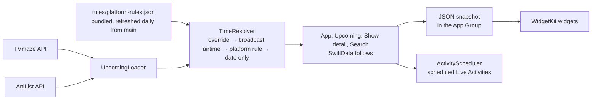

<p align="center">
  <picture>
    <source media="(prefers-color-scheme: dark)" srcset="docs/readme/meridian-mark-dark.svg">
    <source media="(prefers-color-scheme: light)" srcset="docs/readme/meridian-mark-light.svg">
    
  </picture>
</p>

<h1 align="center">Meridian</h1>

<p align="center">
  <b>How long until your next episode, in your time zone, and where it's on.</b><br>
  A local-first iPhone app with Lock Screen and Home Screen widgets and a release-night Live Activity.<br>
  Every time says how sure it is, in plain words, and where it came from.
</p>

<p align="center">
  <a href="https://github.com/ChimeXXD/meridian/actions/workflows/ci.yml"></a>
  <a href="https://github.com/ChimeXXD/meridian/releases"></a>
  <a href="LICENSE"></a>
  
  
  
</p>

<p align="center">
  <a href="https://meridian-designsystem.vercel.app"><b>Design system</b></a> ·
  <a href="docs/CASE-STUDY.md"><b>Case study</b></a> ·
  <a href="docs/research/accuracy-audit.md"><b>Accuracy audit</b></a> ·
  <a href="PRIVACY.md"><b>Privacy</b></a> ·
  <a href="https://github.com/ChimeXXD/meridian/issues/new"><b>Report a wrong time</b></a>
</p>

<p align="center">
  
</p>

<p align="center"><sub>Screenshots use the app's built-in sample schedule. Show artwork is loaded from TVmaze and AniList while the
app runs and belongs to its owners; it's never stored in this repository.</sub></p>

---

> [!NOTE]
> **v0.1.0 is a private beta**, built in one week (29 Oct to 5 Nov 2026) as a portfolio project. There's no App Store
> release: build it yourself with a free Apple ID ([Get started](#get-started)). Free-signed builds run for 7 days.

**Contents:** [Why Meridian](#why-meridian) · [What it does](#what-it-does) · [Every time says how sure it is](#every-time-says-how-sure-it-is) ·
[How it works](#how-it-works) · [Accuracy](#accuracy) · [Design system](#design-system) · [Get started](#get-started) ·
[Quality gates](#quality-gates) · [Repository map](#repository-map) · [Docs](#docs) · [Privacy](#privacy) ·
[Status and roadmap](#status-and-roadmap) · [Contributing](#contributing) · [Credits and licence](#credits-and-licence)

## Why Meridian

Release times are set in the platform's home zone. Netflix drops at midnight Pacific, Apple TV the evening before
in New York, anime on Japanese TV. A viewer in Lagos, London or Kolkata has to do that maths, and the apps that do it
for them get it wrong in quiet ways: TVmaze, the data most trackers use, gives a streaming episode with no published
time a **fake noon placeholder**, and apps show it as if it were real.

Meridian does the maths for your zone and is honest when a time is only an estimate. It was built for a viewer in
Lagos (UTC+1, no daylight saving) first.

## What it does

| | |
|---|---|
|  | **Upcoming and Show detail.** The next episode as a countdown, the time in your zone in words ("Expected tomorrow at 00:43 Lagos time"), the service and its country, and one sentence on where the time came from. A published time that moves later says "Delayed from 20:55". Anime get a stream delay after their Japanese broadcast. |
|  | **Search.** TV from TVmaze, anime from AniList, with what's airing this week filtered by your services. Follow in one tap; unfollowing always asks. |
|  | **Widgets.** Small, medium and large on the Home Screen; inline, circular and rectangular on the Lock Screen. The countdown ticks in the last 24 hours and reads "4d 4h" before that. They never count up. |
|  | **Release-night Live Activity.** Scheduled before the episode (iOS 26), on the Lock Screen and in the Dynamic Island, then "Out now" in gold with no app running. Same-night episodes merge into one; at most 3 are booked at a time. |
|  | **Local-first.** No account, no server, no analytics. Times refresh when you open the app (at most 15 minutes old) and work offline with "Updated 14:05". |

## Every time says how sure it is

Certainty is a word, never a colour code ([D-40](docs/DECISIONS.md)).

| Where the time comes from | The app says | Show detail explains |
|---|---|---|
| A broadcaster's published air time | "Out today at 21:00" | "That's when HBO airs it in its home zone: Mon 20:06 New York time." |
| A platform's usual release rule | "Expected Fri at 02:00" | "Apple TV doesn't publish release times, so this is when its new episodes usually arrive." |
| Japanese TV (anime) | "Airs in Japan tomorrow at 01:24" | "This is when it airs on Japanese TV. Streaming services may add it a little later." |
| A date with no time | "Out Thu 19 Nov, time not announced" | No countdown, ever. |
| A sourced correction (rules file) | "Out" or "Expected", as sure as its source | "This time was checked and confirmed." or "This time was reported but isn't confirmed yet." |

## How it works



- **Times are stored as UTC** and formatted only in the view, in your zone. A date-only episode keeps its listed
  date so it never lands on the wrong day.
- **TVmaze's placeholder is detected by its empty airtime**, never by the hour, and replaced by a rule or shown as
  date only.
- **Widgets read a JSON snapshot** the app writes to the App Group, not the database, and each timeline is built so
  a countdown never counts up and a still "2d 4h" never lags an hour.
- **Live Activities are booked ahead** with `Activity.request(… start:)`, end themselves at the drop through their
  stale date, move when a time is delayed, and are booked again when the lead time changes.

## Accuracy

The [accuracy audit](docs/research/accuracy-audit.md) checked 20 real episodes from the build week, across 15
services in the US, the UK and Japan, against independently confirmed release times, in Lagos.

| | Correct (right day, within 5 minutes) |
|---|---|
| First pass | 14 of 18 |
| After four sourced overrides | **20 of 20**, including both sides of the 1 Nov US clock change |

The misses were live events on streamers (WWE Raw on Netflix, Thursday Night Football on Prime), Netflix anime on
Japan's schedule, and a Japanese broadcast that ran 40 minutes late. They're fixed in the rules file, which the app
fetches from `main`, so corrections reach phones without an app update. The audit reruns with every test pass.

## Design system

<p align="center">
  <a href="https://meridian-designsystem.vercel.app"></a>
</p>

**[meridian-designsystem.vercel.app](https://meridian-designsystem.vercel.app)**: the Night Sky colours, type,
countdown states, every component, and the widgets and Live Activity on iPhone mockups with real show art. The app is
its source of truth: the widget and Live Activity pictures on the site are the app's own renders, and the tests fail if
the two ever differ (`scripts/sync-design-system-renders.sh` updates the site).

## Get started

**You need** a Mac with Xcode 26 or later, [XcodeGen](https://github.com/yonaskolb/XcodeGen) (`brew install xcodegen`),
and, to run it on a phone, a free Apple ID. There are no third-party packages.

```bash
git clone https://github.com/ChimeXXD/meridian.git && cd meridian
cp Config/Signing.local.xcconfig.example Config/Signing.local.xcconfig
# In Signing.local.xcconfig: your Team ID (Xcode › Settings › Accounts) and your own BUNDLE_PREFIX, e.g. com.yourname
xcodegen generate
open Meridian.xcodeproj   # run the Meridian scheme on a simulator or your iPhone
```

The App Group follows your bundle prefix (`group.<prefix>.meridian`), so widgets work on a free account. Debug builds
have launch options for demos: `-designPreview` shows a sample schedule with real art, `-fakeActivity 5` starts a
Live Activity five minutes from release.

## Quality gates

| Check | What it proves |
|---|---|
| **About 290 unit tests** (Swift Testing) | Time rules across six zones and both sides of the US and EU clock changes; placeholders; delays; wording; widget timelines; Live Activity scheduling |
| **The accuracy audit** | 20 real episodes against confirmed times |
| **Screen checks** (`fidelity/verify-screen.sh`, 12 UI tests) | Every screen shows its items with their exact copy; swipe back works |
| **Render sync** | The design system's widget and Live Activity pictures equal the app's renders |
| **CI** ([GitHub Actions](https://github.com/ChimeXXD/meridian/actions)) | Build and every test on macOS, on each push and pull request |

```bash
xcodebuild -scheme Meridian -destination 'platform=iOS Simulator,name=iPhone 17 Pro' test
fidelity/verify-screen.sh      # every screen
```

## Repository map

```
Meridian/            the app: screens (Features/), services, scheduling
MeridianWidgets/     widgets and the Live Activity
Shared/              compiled into both: models, time rules, wording, design tokens
MeridianTests/       Swift Testing; Fixtures/ holds recorded API JSON (see its README)
MeridianUITests/     screen checks and navigation tests
rules/               platform-rules.json (release rules and sourced overrides), service logos
design-system/       the design system site (deployed on Vercel)
fidelity/            screen inventories and screenshots for the screen checks
docs/                plan, spec, decisions, research, audits, case study
scripts/             fixture recorder, render sync, app icon
```

## Docs

| File | What's in it |
|---|---|
| [`docs/CASE-STUDY.md`](docs/CASE-STUDY.md) | The story of the build: problem, research, design, engineering, accuracy |
| [`docs/research/accuracy-audit.md`](docs/research/accuracy-audit.md) | 20 real episodes, each with its source |
| [`docs/design/UX-AUDIT.md`](docs/design/UX-AUDIT.md) | A 34-finding UX and accessibility audit and what was fixed |
| [`docs/DECISIONS.md`](docs/DECISIONS.md) | Every product and architecture decision, with its reason |
| [`docs/SPEC.md`](docs/SPEC.md) | Screens, data model, time rules, widgets, Live Activity |
| [`docs/PLAN.md`](docs/PLAN.md) | The one-week plan, day by day |
| [`docs/RESEARCH.md`](docs/RESEARCH.md) | Platform release times and competitors, with sources |
| [`PROGRESS.md`](PROGRESS.md) | The build log |
| [`CLAUDE.md`](CLAUDE.md) | The rules the coding agent works to |

## Privacy

Meridian collects nothing. It talks only to TVmaze, AniList and Wikimedia (for service logos), and keeps your follows
on your phone. [PRIVACY.md](PRIVACY.md) lists every request and everything it stores.

## Status and roadmap

**v0.1.0, private beta.** Built in one week as a portfolio project; not on the App Store.

Next, if it continues (from [the plan](docs/PLAN.md)): a regression check at the March 2027 clock changes (US 14 Mar,
EU 28 Mar), region-aware "where to watch" through TMDB, StandBy and the extra-large widget, and more sourced
overrides for live events and anime on global streamers.

## Contributing

Seen a wrong time? **[Report it](https://github.com/ChimeXXD/meridian/issues/new)**: the app's "Report a wrong time"
opens a prefilled issue with the show, the time it showed and where that came from. Fixes usually go into
`rules/platform-rules.json` as a sourced override, which reaches every phone the next day. Pull requests are welcome;
please run the tests first.

## Credits and licence

- **Code:** [MIT](LICENSE).
- **TV data:** [TVmaze](https://www.tvmaze.com), [CC BY-SA 4.0](https://creativecommons.org/licenses/by-sa/4.0/).
- **Anime data:** [AniList](https://anilist.co).
- **Service logos:** Wikimedia Commons, each under its own free licence (listed in the app's Credits).
- **Show artwork:** belongs to its owners, loaded at runtime and never stored here.
- **Built by** [Chime](https://chimexd.work) with [Claude Code](https://claude.com/claude-code).

Meridian isn't endorsed by TVmaze, AniList or any streaming service.
