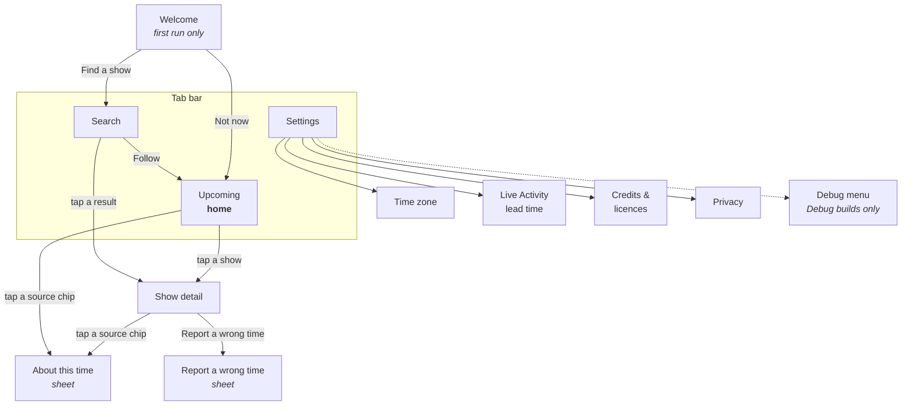
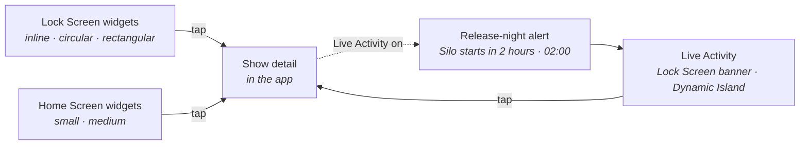
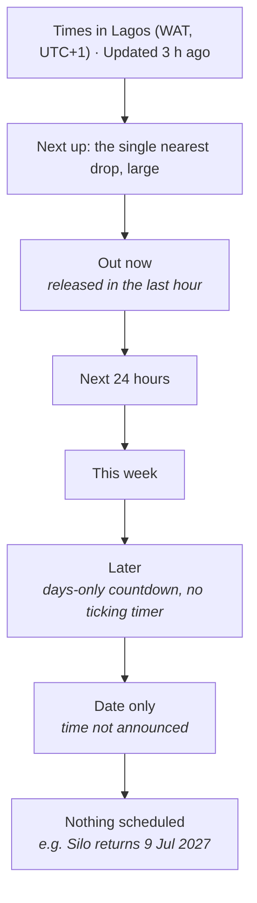
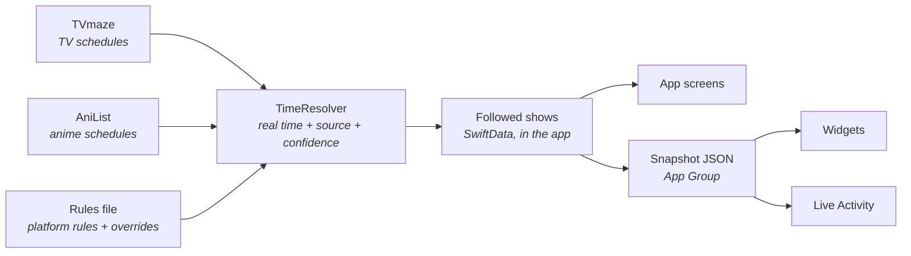

# Meridian sitemap

How the product fits together: the screens inside the app, the surfaces outside it (widgets, Live Activity, alerts), and how you move between them. Built from `docs/SPEC.md` on 30 Oct 2026. The reference board (`docs/design/reference-board/`) uses the same section names.

Meridian is small on purpose: **four screens, three sheets, and four surfaces outside the app.** Most of the time people use it without opening it, from the Lock Screen.

## The map

### Inside the app

### Outside the app

Most glances happen here, on the Lock Screen, without opening the app.

Solid lines are taps. The dotted line is a setting: switching on the Live Activity in Show detail schedules one for release night, which starts with an alert at the lead time.

## Navigation (proposed: needs Chime's OK, O-11)

SPEC lists the screens but not how you move between them. The proposal:

- **A tab bar with three tabs: Upcoming, Settings, and Search.** iOS 26 gives Search its own tab, set apart on the trailing side, so that's where it goes, not as a button.
- **Upcoming is the home screen** and opens first after the welcome screen.
- **Show detail is pushed** from Upcoming, Search, a widget or the Live Activity, with a back button.
- **Sheets** (About this time, Report a wrong time) slide up over the screen you're on.

The alternative is a single Upcoming screen with Search and Settings as toolbar buttons. It's simpler, but it hides Search, which is the first thing a new user needs.

## Screens inside the app

| Screen | What it's for | What's on it | How you get there |
| --- | --- | --- | --- |
| **Welcome** | Explain the app once, then get the first show followed | "Times shown for Lagos, UTC+1", Find a show, a Lock Screen widget preview with steps, Not now | First launch only |
| **Upcoming** (home) | Answer "how long, when, where" for everything you follow | "Times in your zone" line and an "Updated …" stamp; a "Next up" hero; sections below | Opens on launch; Upcoming tab |
| **Search** | Find and follow a show | TV / Anime switch, search field, results with **Year · Network · Status**, a (+) Follow button | Search tab; Welcome → Find a show |
| **Show detail** | Everything about one show | The next-episode block (relative day, big local time, countdown, source chip, where to watch); your time vs broadcast time; the last 3 episodes; the Live Activity toggle; the anime time offset; Report a wrong time; Unfollow | Tap a show anywhere: Upcoming, Search, a widget, the Live Activity |
| **Settings** | Preferences and information | Time zone (automatic or a chosen city), Live Activity lead time (30 min to 6 h), Live Activities permission state, Credits, Privacy, Debug | Settings tab |
| Settings › **Time zone** | Override the device's zone | Automatic switch, city search with offsets and current local time, Lagos pinned | Settings |
| Settings › **Live Activity lead time** | When the release-night activity starts | 30 min, 1 h, 2 h (default), 3 h, 4 h, 6 h, each with the actual local start time | Settings |
| Settings › **Credits & licences** | Data credits and licences | TVmaze (CC BY-SA 4.0, with link), AniList, MIT licence, "No data collected" | Settings |
| Settings › **Privacy** | What the app does and doesn't send | The `PRIVACY.md` text | Settings |
| Settings › **Debug** | Test without waiting for real releases | Fake drop in 2 / 10 / 60 min, fake Live Activity in 3 min, Dump snapshot, Simulate delay +1 h, Reload rules | Debug builds only |

### Sheets

| Sheet | Opens from | What's on it |
| --- | --- | --- |
| **About this time** | Any source chip | Where this time came from (Broadcast, Netflix rule, JP broadcast, Confirmed, Adjusted, Date only), what it means, and the original broadcast time |
| **Report a wrong time** | Show detail | Wrong time / wrong date / wrong platform, an optional note, and what will be sent. Email while the repo is private; a GitHub issue once it's public (D-34) |
| **Unfollow confirmation** | Show detail | "Stop following Silo?", the only destructive action |

## Inside Upcoming

Upcoming is one scrolling list. Empty sections are hidden.

| State | What Upcoming shows |
| --- | --- |
| No shows followed | "Follow a show to see its countdown here", with Find a show |
| Shows followed, nothing scheduled | "Nothing scheduled for your shows yet. Meridian checks again each time you open it." |
| Offline | The last known times plus "Offline · Updated 3 h ago" |
| A time moved later | "Delayed from 21:00" under the new time, in words (D-58) |
| No official stream in your country | The row keeps the provider ("HBO · US") and adds "No official stream in your country" under it |

## Outside the app

| Surface | Sizes | What it shows | Tap goes to |
| --- | --- | --- | --- |
| **Lock Screen widgets** | Inline: "Silo · 2d 4h" · Circular: "2d" with a 7-day ring · Rectangular: name, countdown, "Wed 02:00 · Apple TV" | The next drop | Show detail |
| **Home Screen widgets** | Small: one huge countdown, the name small, the source chip · Medium: the next 3 drops as rows | The next drop(s) | Show detail (small) or that row's show (medium) |
| **Release-night alert** | System alert when the Live Activity starts | "Silo starts in 2 hours · 02:00 · Apple TV" | The Live Activity |
| **Live Activity** | Lock Screen banner; Dynamic Island compact, minimal and expanded | Countdown to the drop, then "Out now" for an hour | Show detail |

The widgets and Live Activity read a JSON snapshot that the app writes (D-05), so they keep counting with the app closed.

## Key journeys

1. **First run:** Welcome → Find a show → Search → Follow → Upcoming, with a prompt to add a Lock Screen widget.
2. **The everyday glance:** Lock Screen widget "Silo · 2d 4h" → tap if needed → Show detail.
3. **Release night:** Live Activity switched on in Show detail → at the lead time, alert plus Live Activity → the Dynamic Island counts down → "Out now" → it ends an hour later.
4. **"Can I trust this time?":** tap the source chip → About this time → if it's wrong → Report a wrong time.
5. **Travelling or using a VPN:** Settings → Time zone → choose a city → every time, widget and Live Activity updates.

## Behind the screens

No account and no server. The only network calls go to TVmaze and AniList, plus the rules file once the repo is public.
